# Nexus Plugin Atlas

Nexus Wang 的 uni-app 插件公开文档集合与画廊。

在线查看：[插件集合与真实演示画廊](https://awak3n1ngone.github.io/nexus-uniapp-plugins/)

本次收录 25 个插件入口、23 篇说明、22 款实机画面、26 张真实截图。


## 全部插件 · 封面画廊

点击封面或说明链接阅读文档。封面是品牌展示图，实机截图请进入在线画廊；AIKit与365DailyCard为市场外链条目，使用明确标注的目录占位封面。新开发插件尚未上架时不提供虚构的市场入口。

<table>
<tr>
<td width="33%" valign="top"><a href="docs/aiko-scan-pro.md">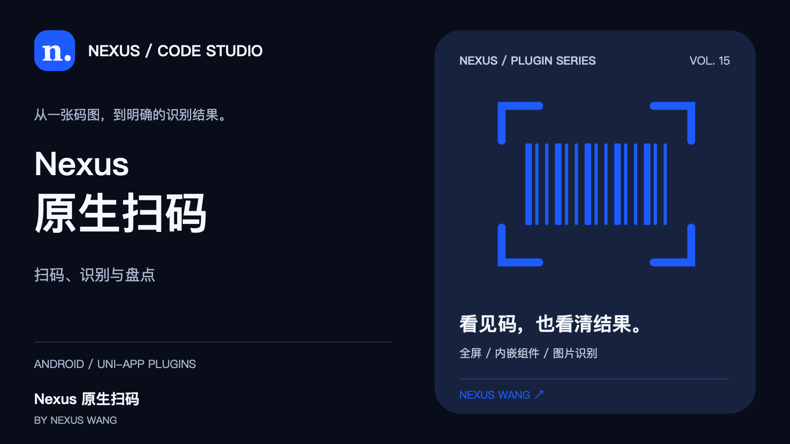</a><br><strong>Nexus 原生扫码</strong><br><sub>已上架 · 本轮升级待发布</sub><br><a href="docs/aiko-scan-pro.md">说明文档</a> · <a href="https://awak3n1ngone.github.io/nexus-uniapp-plugins/#plugin=aiko-scan-pro">在线详情</a> · <a href="https://ext.dcloud.net.cn/plugin?name=aiko-scan-pro">插件市场</a></td>
<td width="33%" valign="top"><a href="docs/nexus-sqlite-core.md">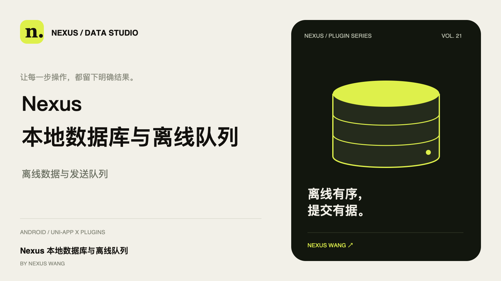</a><br><strong>Nexus 本地数据库与离线队列</strong><br><sub>本地开发 · 尚未上架</sub><br><a href="docs/nexus-sqlite-core.md">说明文档</a> · <a href="https://awak3n1ngone.github.io/nexus-uniapp-plugins/#plugin=nexus-sqlite-core">在线详情</a></td>
<td width="33%" valign="top"><a href="docs/nexus-file-workflow.md">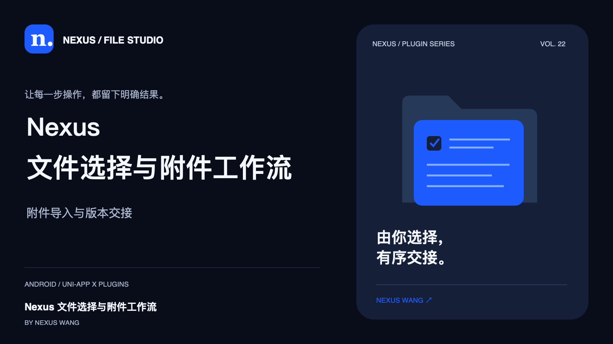</a><br><strong>Nexus 文件与附件工作流</strong><br><sub>本地开发 · 尚未上架</sub><br><a href="docs/nexus-file-workflow.md">说明文档</a> · <a href="https://awak3n1ngone.github.io/nexus-uniapp-plugins/#plugin=nexus-file-workflow">在线详情</a></td>
</tr>
<tr>
<td width="33%" valign="top"><a href="docs/aiko-ble-core.md">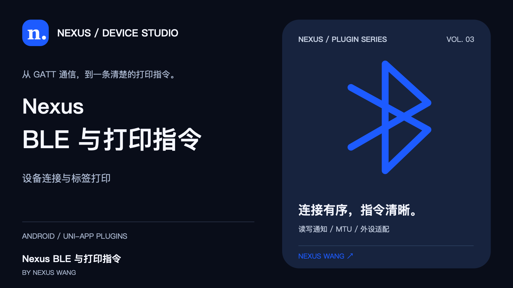</a><br><strong>Nexus BLE 与打印指令</strong><br><sub>已上架 · 本轮升级待发布</sub><br><a href="docs/aiko-ble-core.md">说明文档</a> · <a href="https://awak3n1ngone.github.io/nexus-uniapp-plugins/#plugin=aiko-ble-core">在线详情</a> · <a href="https://ext.dcloud.net.cn/plugin?name=aiko-ble-core">插件市场</a></td>
<td width="33%" valign="top"><a href="docs/aiko-doc-scan.md">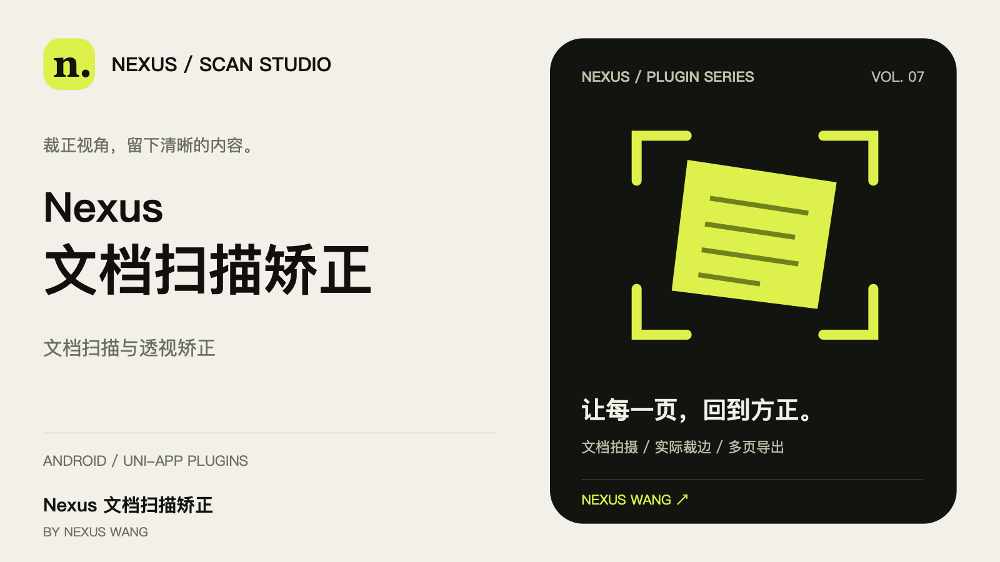</a><br><strong>Nexus 文档扫描矫正</strong><br><sub>已上架 · 本轮升级待发布</sub><br><a href="docs/aiko-doc-scan.md">说明文档</a> · <a href="https://awak3n1ngone.github.io/nexus-uniapp-plugins/#plugin=aiko-doc-scan">在线详情</a> · <a href="https://ext.dcloud.net.cn/plugin?name=aiko-doc-scan">插件市场</a></td>
<td width="33%" valign="top"><a href="docs/aiko-doc-viewer.md">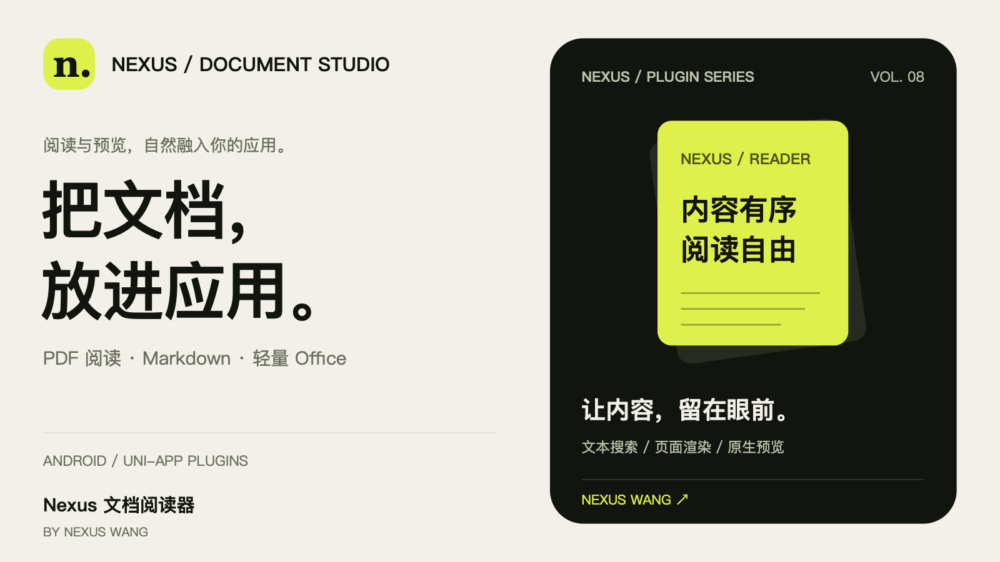</a><br><strong>Nexus 文档阅读器</strong><br><sub>已上架 · 本轮升级待发布</sub><br><a href="docs/aiko-doc-viewer.md">说明文档</a> · <a href="https://awak3n1ngone.github.io/nexus-uniapp-plugins/#plugin=aiko-doc-viewer">在线详情</a> · <a href="https://ext.dcloud.net.cn/plugin?name=aiko-doc-viewer">插件市场</a></td>
</tr>
<tr>
<td width="33%" valign="top"><a href="docs/aiko-image-edit.md">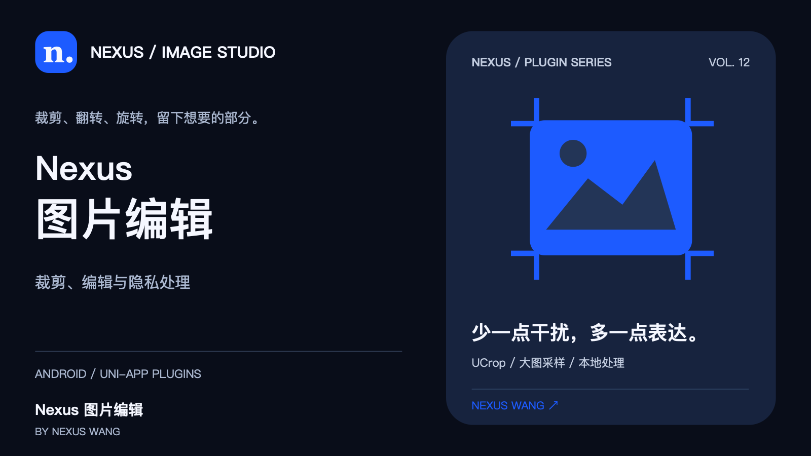</a><br><strong>Nexus 图片编辑</strong><br><sub>已上架 · 本轮升级待发布</sub><br><a href="docs/aiko-image-edit.md">说明文档</a> · <a href="https://awak3n1ngone.github.io/nexus-uniapp-plugins/#plugin=aiko-image-edit">在线详情</a> · <a href="https://ext.dcloud.net.cn/plugin?name=aiko-image-edit">插件市场</a></td>
<td width="33%" valign="top"><a href="docs/aiko-gallery-hub.md">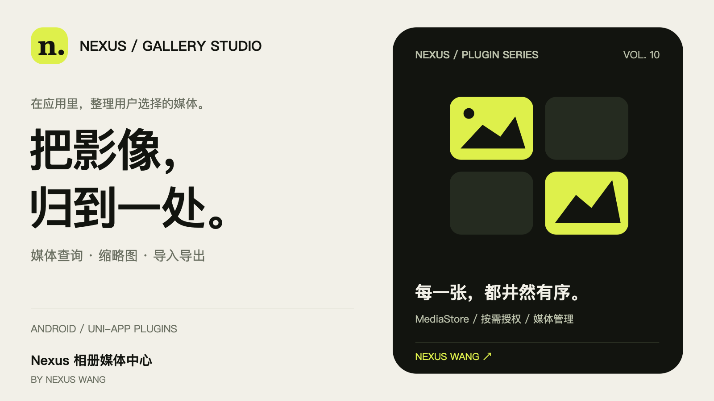</a><br><strong>Nexus 相册媒体中心</strong><br><sub>已上架 · 本轮升级待发布</sub><br><a href="docs/aiko-gallery-hub.md">说明文档</a> · <a href="https://awak3n1ngone.github.io/nexus-uniapp-plugins/#plugin=aiko-gallery-hub">在线详情</a> · <a href="https://ext.dcloud.net.cn/plugin?name=aiko-gallery-hub">插件市场</a></td>
<td width="33%" valign="top"><a href="docs/aiko-video-edit.md">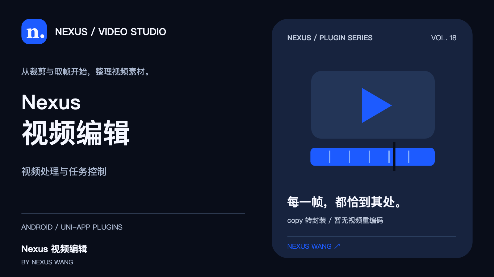</a><br><strong>Nexus 视频编辑</strong><br><sub>已上架 · 本轮升级待发布</sub><br><a href="docs/aiko-video-edit.md">说明文档</a> · <a href="https://awak3n1ngone.github.io/nexus-uniapp-plugins/#plugin=aiko-video-edit">在线详情</a> · <a href="https://ext.dcloud.net.cn/plugin?name=aiko-video-edit">插件市场</a></td>
</tr>
<tr>
<td width="33%" valign="top"><a href="docs/aiko-video-thumb.md">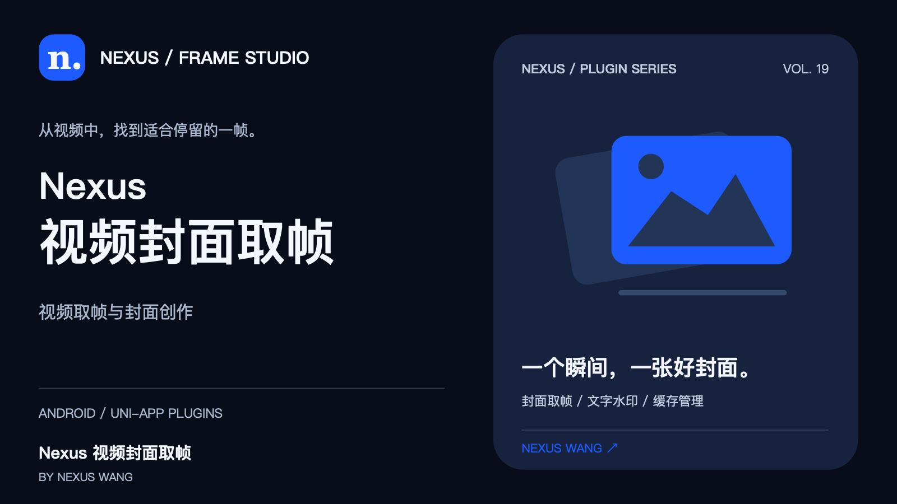</a><br><strong>Nexus 视频封面取帧</strong><br><sub>已上架 · 本轮升级待发布</sub><br><a href="docs/aiko-video-thumb.md">说明文档</a> · <a href="https://awak3n1ngone.github.io/nexus-uniapp-plugins/#plugin=aiko-video-thumb">在线详情</a> · <a href="https://ext.dcloud.net.cn/plugin?name=aiko-video-thumb">插件市场</a></td>
<td width="33%" valign="top"><a href="docs/aiko-bg-audio.md">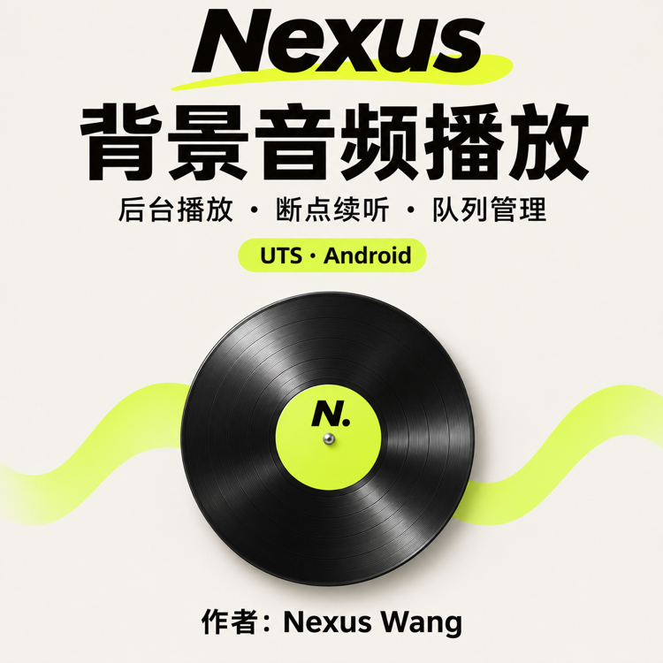</a><br><strong>Nexus 背景音频播放</strong><br><sub>独立维护 · 查看市场状态</sub><br><a href="docs/aiko-bg-audio.md">说明文档</a> · <a href="https://awak3n1ngone.github.io/nexus-uniapp-plugins/#plugin=aiko-bg-audio">在线详情</a> · <a href="https://ext.dcloud.net.cn/plugin?name=aiko-bg-audio">插件市场</a></td>
<td width="33%" valign="top"><a href="docs/aiko-smart-tts.md"></a><br><strong>Nexus 系统语音播报</strong><br><sub>已上架</sub><br><a href="docs/aiko-smart-tts.md">说明文档</a> · <a href="https://awak3n1ngone.github.io/nexus-uniapp-plugins/#plugin=aiko-smart-tts">在线详情</a> · <a href="https://ext.dcloud.net.cn/plugin?name=aiko-smart-tts">插件市场</a></td>
</tr>
<tr>
<td width="33%" valign="top"><a href="docs/aiko-asr.md">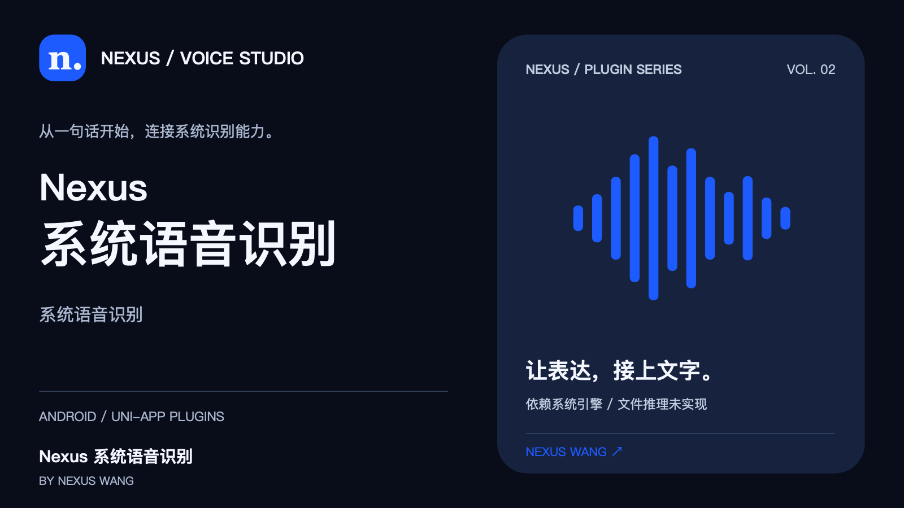</a><br><strong>Nexus 系统语音识别</strong><br><sub>已上架</sub><br><a href="docs/aiko-asr.md">说明文档</a> · <a href="https://awak3n1ngone.github.io/nexus-uniapp-plugins/#plugin=aiko-asr">在线详情</a> · <a href="https://ext.dcloud.net.cn/plugin?name=aiko-asr">插件市场</a></td>
<td width="33%" valign="top"><a href="docs/aiko-call-recorder.md">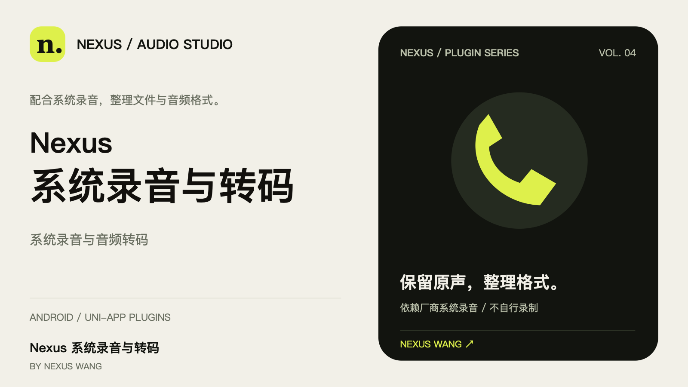</a><br><strong>Nexus 系统录音与转码</strong><br><sub>已上架</sub><br><a href="docs/aiko-call-recorder.md">说明文档</a> · <a href="https://awak3n1ngone.github.io/nexus-uniapp-plugins/#plugin=aiko-call-recorder">在线详情</a> · <a href="https://ext.dcloud.net.cn/plugin?name=aiko-call-recorder">插件市场</a></td>
<td width="33%" valign="top"><a href="docs/aiko-live-player.md">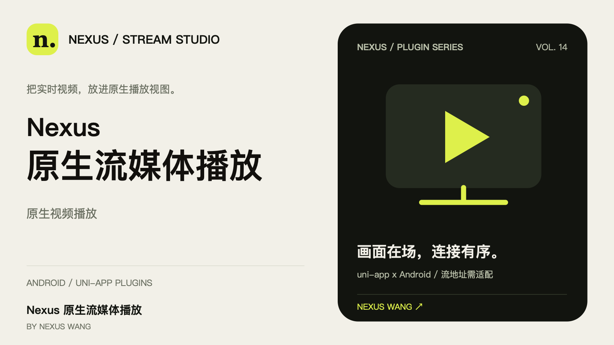</a><br><strong>Nexus 原生流媒体播放</strong><br><sub>已上架</sub><br><a href="docs/aiko-live-player.md">说明文档</a> · <a href="https://awak3n1ngone.github.io/nexus-uniapp-plugins/#plugin=aiko-live-player">在线详情</a> · <a href="https://ext.dcloud.net.cn/plugin?name=aiko-live-player">插件市场</a></td>
</tr>
<tr>
<td width="33%" valign="top"><a href="docs/aiko-cast-core.md">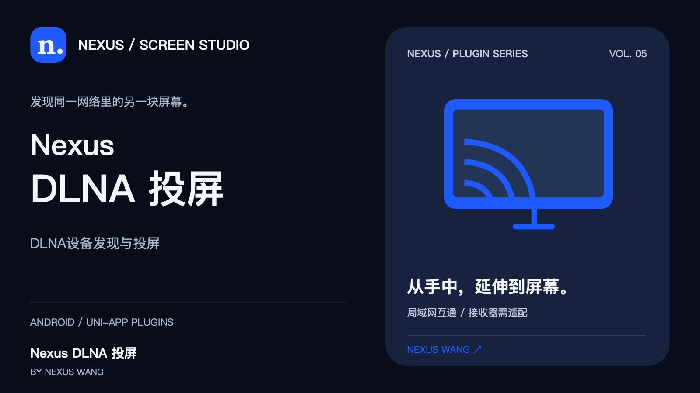</a><br><strong>Nexus DLNA 投屏</strong><br><sub>已上架</sub><br><a href="docs/aiko-cast-core.md">说明文档</a> · <a href="https://awak3n1ngone.github.io/nexus-uniapp-plugins/#plugin=aiko-cast-core">在线详情</a> · <a href="https://ext.dcloud.net.cn/plugin?name=aiko-cast-core">插件市场</a></td>
<td width="33%" valign="top"><a href="docs/aiko-share-core.md">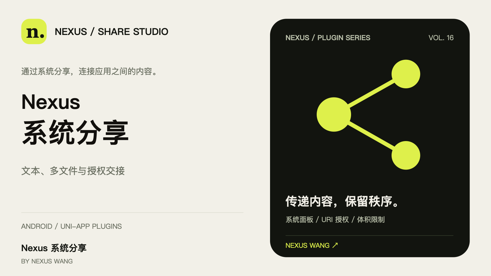</a><br><strong>Nexus 系统分享</strong><br><sub>已上架</sub><br><a href="docs/aiko-share-core.md">说明文档</a> · <a href="https://awak3n1ngone.github.io/nexus-uniapp-plugins/#plugin=aiko-share-core">在线详情</a> · <a href="https://ext.dcloud.net.cn/plugin?name=aiko-share-core">插件市场</a></td>
<td width="33%" valign="top"><a href="docs/aiko-geo-core.md">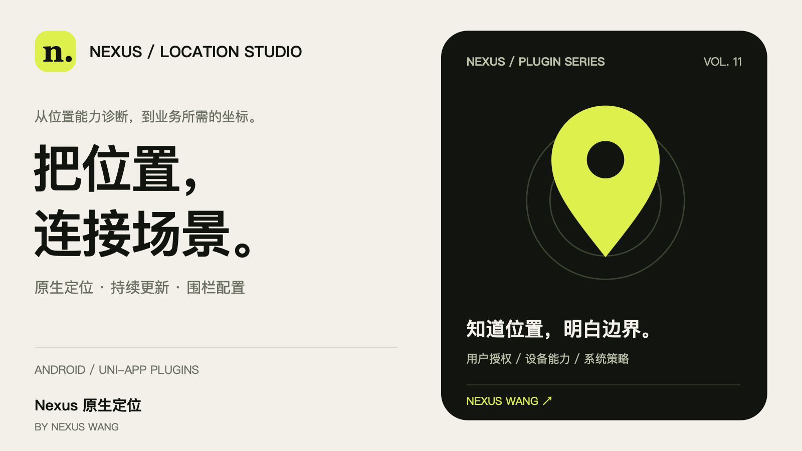</a><br><strong>Nexus 原生定位</strong><br><sub>已上架</sub><br><a href="docs/aiko-geo-core.md">说明文档</a> · <a href="https://awak3n1ngone.github.io/nexus-uniapp-plugins/#plugin=aiko-geo-core">在线详情</a> · <a href="https://ext.dcloud.net.cn/plugin?name=aiko-geo-core">插件市场</a></td>
</tr>
<tr>
<td width="33%" valign="top"><a href="docs/aiko-device-id.md">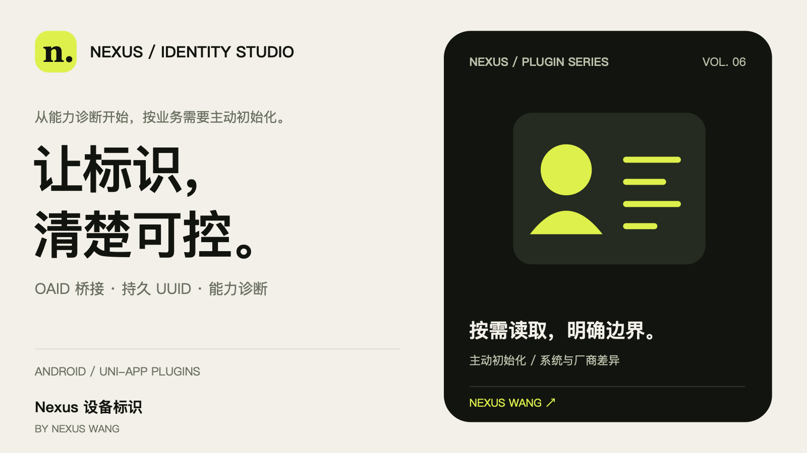</a><br><strong>Nexus 设备标识</strong><br><sub>已上架</sub><br><a href="docs/aiko-device-id.md">说明文档</a> · <a href="https://awak3n1ngone.github.io/nexus-uniapp-plugins/#plugin=aiko-device-id">在线详情</a> · <a href="https://ext.dcloud.net.cn/plugin?name=aiko-device-id">插件市场</a></td>
<td width="33%" valign="top"><a href="docs/aiko-keep-alive.md">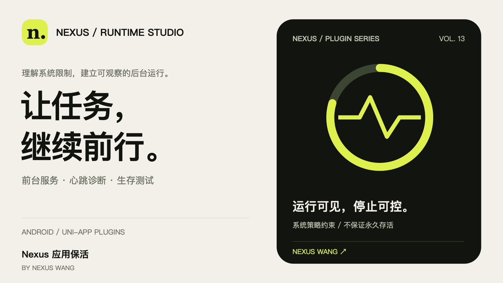</a><br><strong>Nexus 应用保活</strong><br><sub>已上架</sub><br><a href="docs/aiko-keep-alive.md">说明文档</a> · <a href="https://awak3n1ngone.github.io/nexus-uniapp-plugins/#plugin=aiko-keep-alive">在线详情</a> · <a href="https://ext.dcloud.net.cn/plugin?name=aiko-keep-alive">插件市场</a></td>
<td width="33%" valign="top"><a href="docs/aiko-float-window.md">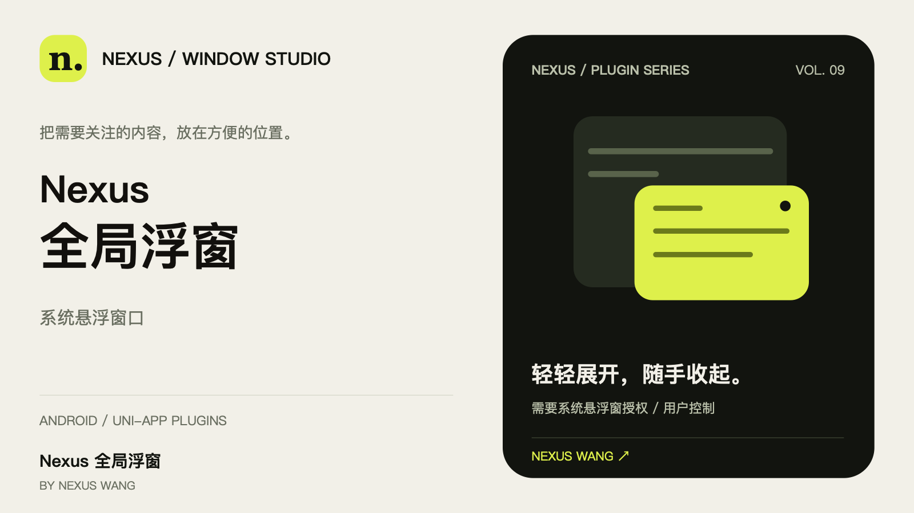</a><br><strong>Nexus 全局浮窗</strong><br><sub>已上架</sub><br><a href="docs/aiko-float-window.md">说明文档</a> · <a href="https://awak3n1ngone.github.io/nexus-uniapp-plugins/#plugin=aiko-float-window">在线详情</a> · <a href="https://ext.dcloud.net.cn/plugin?name=aiko-float-window">插件市场</a></td>
</tr>
<tr>
<td width="33%" valign="top"><a href="docs/aiko-alipay-core.md">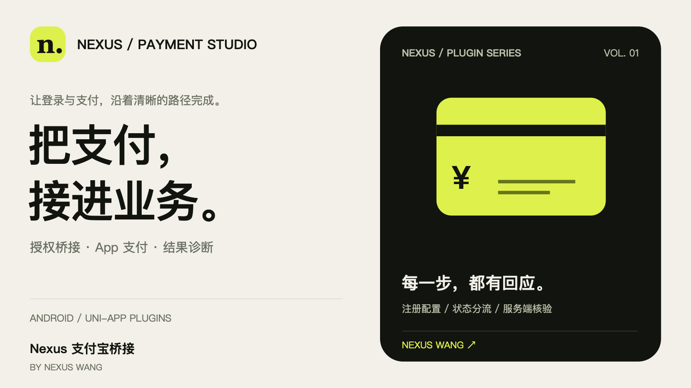</a><br><strong>Nexus 支付宝桥接</strong><br><sub>已上架</sub><br><a href="docs/aiko-alipay-core.md">说明文档</a> · <a href="https://awak3n1ngone.github.io/nexus-uniapp-plugins/#plugin=aiko-alipay-core">在线详情</a> · <a href="https://ext.dcloud.net.cn/plugin?name=aiko-alipay-core">插件市场</a></td>
<td width="33%" valign="top"><a href="docs/aiko-wechat-core.md">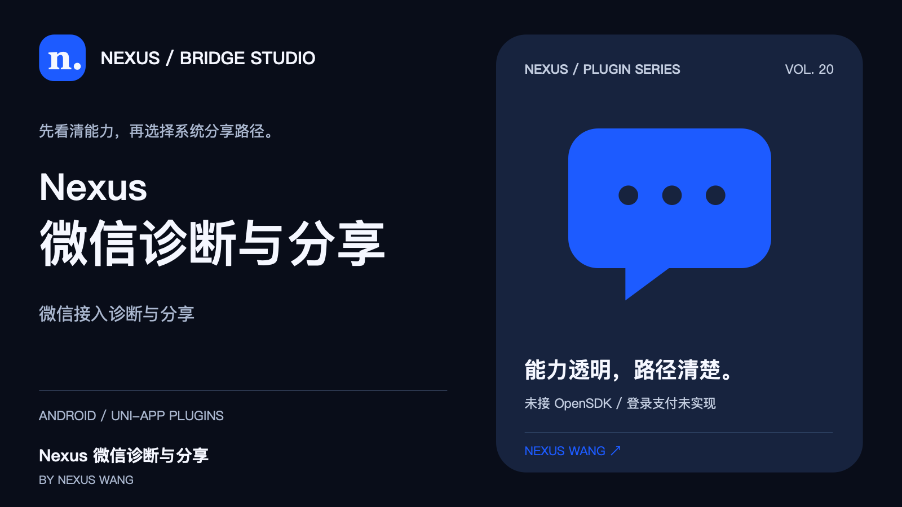</a><br><strong>Nexus 微信诊断与分享</strong><br><sub>已上架</sub><br><a href="docs/aiko-wechat-core.md">说明文档</a> · <a href="https://awak3n1ngone.github.io/nexus-uniapp-plugins/#plugin=aiko-wechat-core">在线详情</a> · <a href="https://ext.dcloud.net.cn/plugin?name=aiko-wechat-core">插件市场</a></td>
<td width="33%" valign="top"><a href="https://ext.dcloud.net.cn/plugin?id=28709">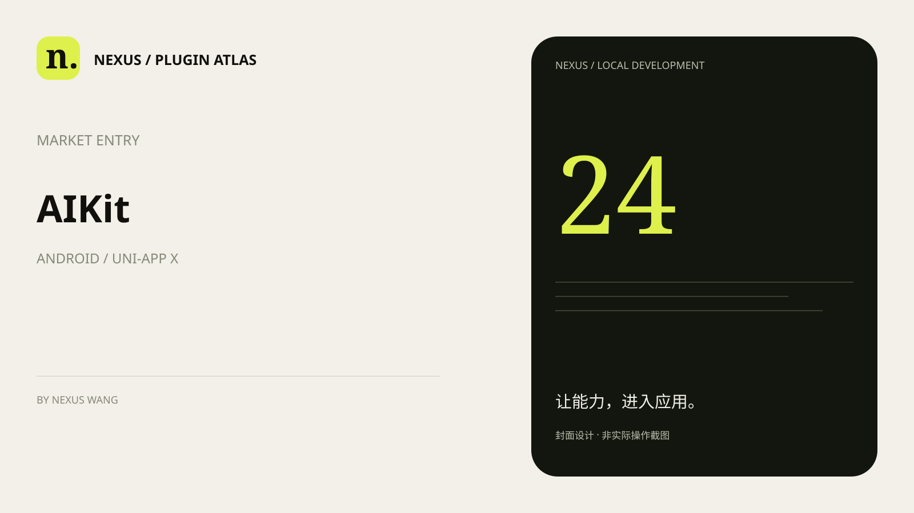</a><br><strong>AIKit</strong><br><sub>市场条目 · 目录占位封面</sub><br><a href="https://awak3n1ngone.github.io/nexus-uniapp-plugins/#plugin=aikit">在线详情</a> · <a href="https://ext.dcloud.net.cn/plugin?id=28709">插件市场</a></td>
</tr>
<tr>
<td width="33%" valign="top"><a href="https://ext.dcloud.net.cn/plugin?id=22200">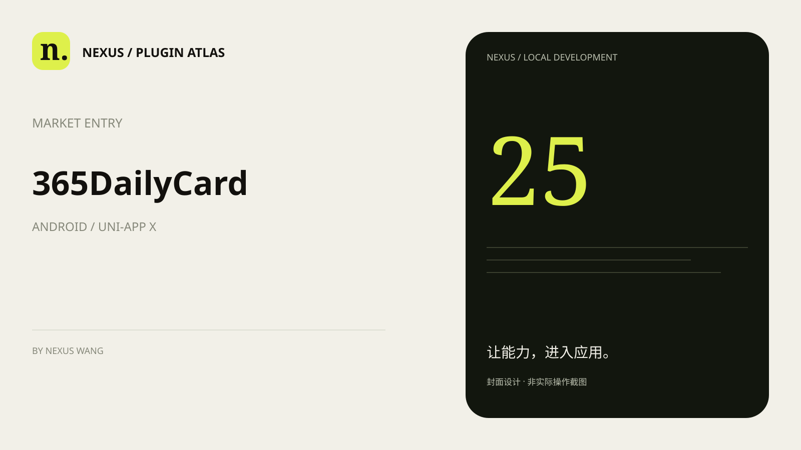</a><br><strong>365DailyCard</strong><br><sub>市场条目 · 目录占位封面</sub><br><a href="https://awak3n1ngone.github.io/nexus-uniapp-plugins/#plugin=365dailycard">在线详情</a> · <a href="https://ext.dcloud.net.cn/plugin?id=22200">插件市场</a></td>
<td></td>
<td></td>
</tr>
</table>

- 搜索与分类筛选、封面/Android实机图切换、完整README阅读、市场外链。
- 新开发未上架、已发布旧版本与本轮升级分别标注。没有用本地版本冒充已发布版本。
- 仅包含公开说明、封面及审核过的展示截图，不包含收费插件源码、APK或密钥。
- 默认/待授权截图说明页面真实显示，不等于所有功能已经验收。外设、平台限制请读每款README。

## 本地查看

在本目录运行 `python3 -m http.server 18768`，浏览器打开 `http://127.0.0.1:18768`。使用HTTP而不是file协议，以便加载catalog.json。无npm安装或构建依赖，不加载外部字体或CDN脚本。

## 更新

导出脚本仅在作者本地有原工程时运行：

```sh
python3 build-catalog.py --project '/path/to/uniapp-project' --outputs '/path/to/public-outputs' --github 'https://github.com/OWNER/REPO'
```

仅复制明确的readme.md、cover.png和展示截图白名单，不复制utssdk目录。脚本支持`--overrides`指定最终发布/测试状态JSON；构建后请重新浏览核对。源工程路径由--project显式传入，仅用于本地导出；GitHub Actions不会读取本地工程。

## GitHub Pages

仓库提供Pages部署workflow；仓库Settings → Pages的Source选择GitHub Actions后，推送main自动发布静态页面。GitHub Pages地址和发布状态以实际部署为准。

## 内容与安全

README使用DOM节点安全渲染：不解析原始HTML、不使用innerHTML、不执行文档脚本。仅允许http(s)/mailto与本站明确的文档资源链接；下载的说明Markdown仍是文本。插件版本与实际购买价请核对各自官方市场页。

作者：Nexus Wang。展示文档不改变各插件的商业授权条件。
