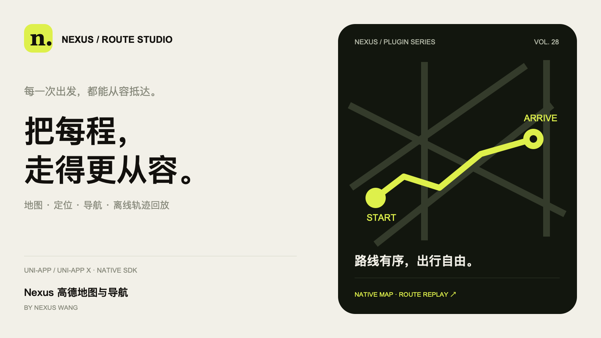
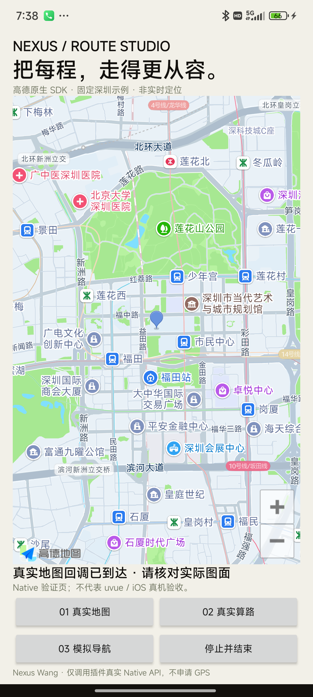
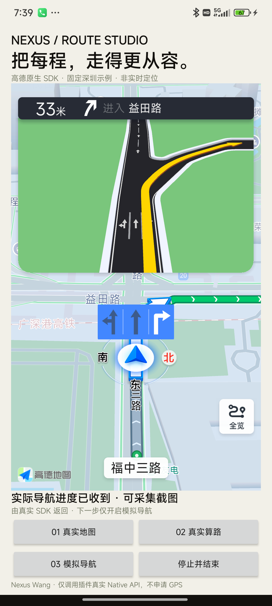

# Nexus 高德地图与导航

把每程，走得更从容。作者：**Nexus Wang**。

基于高德原生 SDK 的嵌入式地图、前台定位、地点搜索、地址解析和多方式导航插件。新增独立的**本地离线轨迹记录与回放**：无需地图 Key 即可保存显式提交的坐标、暂停续记、回放、导出和删除。地图画面由真实 SDK 提供；封面中的路线只是品牌图形。



## 价格与服务授权

| 授权 | 价格 |
| --- | ---: |
| 普通授权版 | ¥79.90 |
| 源码授权版 | ¥2499.00 |

插件授权与高德账号的服务许可、调用配额、地图/定位/导航及货车服务授权分别配置。插件价格不包含高德商业许可，不附送可转售或共享的 Key。购买前确认自己的应用具备所需服务权限；货车服务未开通时不会降级为小客车路线。具体插件使用范围遵循 DCloud 实际授权订单。

## 平台与构建

| 项目 | 范围 |
| --- | --- |
| uni-app x | Android / iOS，原生组件 |
| uni-app | App nvue 原生组件；示例位于 example/uniapp |
| Android | 最低 API 23；ARM64 / ARMv7，不支持 x86 模拟器 |
| iOS | 最低 iOS 13.4，arm64 真机目标；不承诺 arm64 模拟器支持 |
| Web、小程序、HarmonyOS | 不支持 |
| HBuilderX | 本轮使用 5.34；依赖原生 SDK，必须重制自定义基座 |

Android 固定依赖 `com.amap.api:navi-3dmap-location-search:11.3.100_3dmap11.3.100_loc11.3.101_sea9.8.1`，包含地图、导航、定位和搜索。iOS 固定 Pods 为 AMapNavi 11.2.100、AMapFoundation 1.9.1、AMapSearch 9.8.1、AMapLocation 2.12.2；选择实际发布且完成本轮编译的版本。AMapNavi 自带地图，**不要重复加入 AMap3DMap**。不要将其他版本的高德 JAR、AAR、Framework 或 SO 与本插件依赖叠加。

高德 Key、隐私状态及导航管理器包含进程级状态。宿主应统一管理同一进程的高德 SDK；不支持与另一套未协调的高德插件共同争用单例。地图可创建多个受限实例，同时只能有一个本插件导航视图。腾讯版和高德版的离线轨迹存储各自独立，不能互删对方会话。

## Key 配置与隐私

1. 在[高德开放平台控制台](https://console.amap.com/dev/key/app)创建自己的应用和 Android 或 iOS Key。
2. Android 精确绑定**最终 APK 包名与签名证书 SHA1**。HBuilderX 标准基座、自定义基座、正式包可能使用不同签名，不能混用测试签名。iOS 使用实际 Bundle ID。
3. 在宿主提供的本机配置/受控配置中保存客户端 Key，初始化时传给 `initializeAMapMap`。不要将 Web 服务 SecretKey 或 JS 安全密钥传入本插件，也不要将实际 Key 提交到公开仓库或示例文件。
4. 向使用者说明 SDK 提供方、目的、数据类型及[高德隐私权政策](https://lbs.amap.com/pages/privacy/)，取得明确同意后再设置 `privacyAgreed: true`。未同意时不要挂载组件或构造 SDK 服务。
5. 仅在用户明确点击定位/GPS 导航时调用权限入口；本插件不申请后台定位。iOS 宿主须提供真实用途的 `NSLocationWhenInUseUsageDescription`，本插件附有基础说明。

初始化返回成功表示已配置隐私状态与 Key，**不代表地图、算路或导航服务鉴权成功**。`getAMapMapReadiness` 的 `authorizationVerified` 初始为 false，应结合实际 SDK 服务回包和可见图面验收。

官方资料：[Android SDK 下载](https://lbs.amap.com/api/android-navi-sdk/download)、[Android Maven 集成](https://lbs.amap.com/api/android-sdk/guide/create-project/android-studio-create-project/)、[iOS 导航接入](https://developer.amap.com/api/ios-navi-sdk/guide/create-project/manual-configuration)、[SDK 合规方案](https://lbs.amap.com/compliance-center/check-and-reference/sdkhgsy)。高德未购买商用许可的测试 Key 仅用于短期、少量测试，不能随收费插件交付给买家运行。

## 最小接入

组件必须在 SDK 初始化成功后挂载。完整的本机 Key 输入、显式隐私同意、地图事件、路线选择和离线轨迹页面参见 `example/uniappx/map-demo.uvue` 与 `example/uniapp/map-demo.nvue`。

```vue
<template>
  <nexus-amap v-if="ready" :mapId="mapId" mode="drive"
    :voiceEnabled="false" style="width:100%;height:420px"
    @map-event="onMapEvent" />
</template>
<script setup lang="uts">
import { createAMapMapId, initializeAMapMap, AMapMapInitOptions } from '@/uni_modules/nexus-amap'
const ready = ref(false)
const mapId = ref(createAMapMapId())
function startAfterUserConsent(clientKey: string): void {
  const options: AMapMapInitOptions = {
    key: clientKey,
    privacyAgreed: true,
    success: (_res: UTSJSONObject) => { ready.value = true },
    fail: (err: UTSJSONObject) => { console.log(err['code'] as number | null) }
  }
  initializeAMapMap(options)
}
function onMapEvent(event: UTSJSONObject): void {
  // 使用 type / mapId / data；这里只读取事件类型，不输出 Key。
  console.log(event['type'] as string | null)
}
</script>
```

`mapId` 必须由 `createAMapMapId()` 生成。组件 `mode` 为 `map`、`drive`、`truck`、`walk`、`ride`；挂载后不可改变。切换模式应卸载旧视图，等待销毁，生成新 ID 后重建。组件发出 `map-event` 或 `mount-error`，事件为 `{type,mapId,data}`。App nvue 兼容事件可能位于 `event.detail`，完整示例已处理两种形式。

## 公共接口

地图调用使用 `AMapMapCallOptions`：`{mapId, params?, success?, fail?, complete?}`；初始化使用 `AMapMapInitOptions`；离线轨迹使用 `AMapTrackOptions`：`{params?, success?, fail?, complete?}`。终态回包统一为 `{code,message,data}`，`code=0` 成功，非零失败。回调在主线程，单次终态回调；页面仍须按自己的实例与请求代次忽略过期 UI 更新。

| 接口 | params 核心字段 / 行为 |
| --- | --- |
| initializeAMapMap / getAMapMapReadiness | Key 和隐私配置 / 当前配置状态 |
| revokeAMapMapPrivacy | 停止并销毁自有资源，撤回同意；重新启用需重启进程 |
| setAMapMapCenter | latitude、longitude、zoom（3–20） |
| addAMapMapMarker / removeAMapMapMarker | id、latitude、longitude、title / id |
| addAMapMapPolyline / removeAMapMapPolyline | id、points、width、color / id |
| clearAMapMapOverlays / getAMapMapState | 清理插件自有覆盖物 / 视图状态 |
| searchAMapPOI | keyword、region，或 keyword、center、radius；pageSize、pageIndex |
| geocodeAMapAddress / reverseAMapGeocode | address、region / latitude、longitude |
| planAMapRoutes | mode、origin、destination；返回真实 routes 与 routeId |
| startAMapNavigation / stopAMapNavigation | routeId、simulation、speed、voiceEnabled / 停止自有导航 |
| requestAMapLocationPermission | 用户显式触发的前台权限请求；Android 请求精确定位，iOS 为 WhenInUse |
| getAMapLocation / startAMapLocation / stopAMapLocation | 单次 / 前台连续定位（Android 可设 intervalMs；iOS 使用 SDK 原生更新策略）/ 停止自有定位 |
| measureAMapDistance / measureAMapArea | points、coordinateSystem；球面近似测量，不替代测绘 |
| destroyAMapMap | 销毁指定自有视图 |

本插件 SDK 工作流以高德支持的国内坐标区域为范围，输入均须为 **GCJ02**；iOS 设备定位会先由高德坐标区域判断 API 校验，区域外明确失败，不把 WGS84 标为 GCJ02。接口坐标为：`{latitude,longitude,coordinateSystem:'GCJ02'}`。不能将 WGS84 直接当作 GCJ02。几何输入最多 4096 点；路线返回几何总计最多 4096 点，`geometryTruncated` 表示响应截断，SDK 仍持有完整路线。

### 路线与导航

```ts
const options: AMapMapCallOptions = {
  mapId: currentMapId,
  params: {
    mode: 'drive',
    origin: { latitude: 22.543096, longitude: 114.057865, coordinateSystem: 'GCJ02' },
    destination: { latitude: 22.552400, longitude: 114.077600, coordinateSystem: 'GCJ02' }
  },
  success: (res: UTSJSONObject) => { /* 从 res.data.routes 选择真实 routeId */ }
}
planAMapRoutes(options)
// 算路成功后，在同一视图显式提交 { routeId, simulation: true, speed: 40 }。
```

`routeId` 为 SDK 当前算路结果的**不透明字符串**，不能自造、转为数组索引或跨视图/跨模式复用。Android 的 SDK 路线选择 ID 与 `sdkPathId` 不同；iOS 使用真实 routeGroup 的路线键。

`navigationStart` 返回成功只表示 SDK 接受请求。实际开始、进度、结束分别以真实 SDK 导航事件为准。模拟导航使用固定起终点与 SDK 模拟引擎，不获取手机位置；GPS 导航需显式前台权限。进入后台、视图隐藏/移除、销毁或撤回同意时停止自有定位、导航与语音，回前台不自动恢复导航。

Android 驾车/货车可传最多 16 个 waypoints 和避堵、避高速、避收费策略；步行/骑行不支持途经点。iOS 驾车/货车支持同样的途经点与策略；步行/骑行会拒绝非空途经点及开启的避让策略。

iOS 主动停止返回 `navigation_stop_requested`（SDK stopNavi 返回与 naviMode 读回），不会冒充 `navigation_stopped`；后者仅用于实际 SDK didStopNavi 事件，且不保证每次主动停止都收到。

Android 每个导航视图同时只允许一次算路；请求超时、拒绝或状态不确定后必须销毁并重建视图，以隔离 SDK 没有独立请求令牌的迟到回包。iOS 的独立算路使用闭包代次隔离，实际未完成请求有数量上限。停止请求与真实停止事件应分别处理；不应收到请求回调就认定所有 SDK 工作已经停止。

货车模式需顶层 `licenseNumber` 与完整 `truck`：`{length,width,height,weight,load,axisCount,size}`。长宽高为米；weight 为总吨位，load 为核定载重吨位，axisCount 为轴数，size 为车型级别。高德各平台底层字段含义不同，适配层分别映射，不要直接传原生字段。尺寸范围及可选参数以本轮平台说明为准，非法输入返回失败。缺少货车权限会显示 SDK 真实错误。

语音默认在演示中关闭，可在明确开启后请求。`speech_text` 仅表示 SDK 提供文字，播放开始回调也不能证明物理扬声器已可听；不将它们当成音量或可听验收证据。

## 离线轨迹：新增工作流

| 接口 | 用途 |
| --- | --- |
| createAMapTrack | 创建指定坐标系和时间轴的会话（coordinateSystem、timeMs） |
| appendAMapTrackPoint | 显式提交经纬度、时间等点数据 |
| pauseAMapTrack / resumeAMapTrack / endAMapTrack | 暂停、续记、结束 |
| getAMapTrack / listAMapTracks | 读取真实保存会话 |
| replayAMapTrack | 按时间回放并返回坐标来源与 sourceTimeMs |
| exportAMapTrack | 返回真实 JSON 内容，由宿主决定保存/分享 |
| deleteAMapTrack | 显式删除当前插件自有会话 |

该引擎独立于高德 SDK，不自动定位、联网或上传。存储在应用私有目录，卸载会清除。GCJ02/WGS84 必须明确且同一会话保持一致，不自动转换坐标系。演示中的四个点明确标为合成样例，用来测试暂停间隔、插值和回放，并不冒充采集轨迹；其他已存轨迹的真实性由宿主说明。

## 本轮验证状态

1.0.0 验证记录（2026-11-09）：

| 层级 | 实际完成 |
| --- | --- |
| Android Native / APK | 真实 SDK Kotlin 编译；1677 个资源及 ARM32/64 各 7 个 SO 完整进入 APK；几何 18/18 |
| Android 原生真机 | Redmi 22101317C / Android 14；真实地图可见、返回 3 条驾车路线，实际开始模拟导航、收到 21 次变化的进度、真实 SDK 停止事件；8 个调用均成功、主线程、各一次回调；未申请 GPS |
| HBuilderX Android | 5.34 完整 uvue 演示、Vue3 与 Vue2 nvue 消费者编译通过；不是 uvue/nvue 真机挂载验收 |
| iOS Native / UTS | 真正 iPhoneOS 13.4 arm64 SDK、4 个厂商 Framework、生成的公开 UTS/组件与 DCloud Runtime 类型检查和链接通过；几何 23/23 |
| 离线轨迹 | Kotlin 36/36、Swift 38/38，双插件类型共存、各自私有存储及删除隔离通过 |
| 独立审查 | 生命周期、隐私门禁、回调、超时隔离与 SDK 参数映射检查完成 |

未验收：UTS/uvue 真机页面、iOS 真机及签名包、实时 GPS/连续定位、货车商业服务、步行/骑行真机导航、真实搜索/地址解析及物理可听语音。iOS HBuilder 自动原生构建当前受本机 CocoaPods 环境影响，生成消费者的真实 SDK 类型检查/链接为独立检查，不冒充签名构建。当前真实截图来自独立 Android Native QA 宿主，固定深圳坐标，不代表手机当前位置。





## 常见问题

- 地图空白：先检查原生 SDK 依赖是否真正进入自定义基座、网络、包名、最终签名 SHA1/Bundle ID 和 Key 平台；标准基座不能验证新原生依赖。
- 地图成功但导航失败：地图与导航/货车服务授权不同，核对 SDK 错误码和账号权限，不把鉴权失败改成成功。
- 切模式后算路失败：使用新 mapId 和相应模式的导航视图，不能在 map-only 视图上发导航命令。
- 没有定位权限：模拟导航不需要定位；用户主动定位或 GPS 导航才走权限入口，拒绝权限时保留真实失败。
- 收到回调但页面已退出：宿主须在卸载时销毁组件，回调按实例/代次校验，禁止旧请求重新挂载地图。

